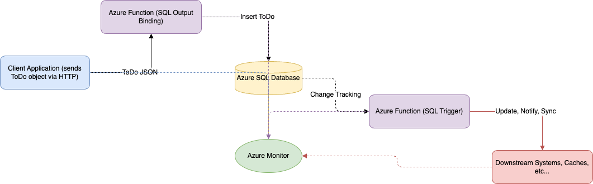

# Azure Functions with SQL Triggers and Bindings (C#)

An Azure Functions QuickStart project that demonstrates how to use both SQL Triggers and SQL Output Bindings with the Azure Developer CLI (azd) for rapid, event-driven integration with Azure SQL Database.

## Architecture



This architecture shows how Azure Functions can both write to and react to changes in an Azure SQL Database using output bindings and triggers. The key components include:

- **Client Applications**: Send HTTP requests to the Azure Function
- **Azure Function with SQL Output Binding**: Receives HTTP requests and writes data to SQL Database
- **Azure Function with SQL Trigger**: Reacts to changes in SQL Database tables
- **Azure SQL Database**: Stores ToDo items
- **Azure Monitor**: Provides logging and metrics for the function execution

This serverless architecture enables scalable, event-driven data ingestion and processing with minimal code.

## Top Use Cases

### SQL Output Binding

1. **Data Ingestion API**: Quickly create APIs that write data to SQL Database without custom data access code.
2. **Serverless CRUD Operations**: Build serverless endpoints for line-of-business apps that interact with SQL data.

### SQL Trigger

1. **Change Data Capture & Auditing**: Automatically react to inserts, updates, or deletes in your SQL tables for auditing, notifications, or downstream processing.
2. **Event-Driven Workflows**: Trigger business logic or integration with other services when data changes in SQL, such as updating caches, sending alerts, or synchronizing systems.

## Features

- SQL Output Binding
- SQL Trigger
- Azure Functions Flex Consumption plan
- Azure Developer CLI (azd) integration for easy deployment
- Infrastructure as Code using Bicep templates

## Getting Started

### Prerequisites

- [.NET 10.0 SDK](https://dotnet.microsoft.com/download/dotnet/10.0)
- [Azure Functions Core Tools v4](https://docs.microsoft.com/azure/azure-functions/functions-run-local#install-the-azure-functions-core-tools)
- [Azure Developer CLI (azd)](https://docs.microsoft.com/azure/developer/azure-developer-cli/install-azd)
- [Azurite](https://github.com/Azure/Azurite) (for local Azure Storage emulation; can be run with `npx azurite`)
- An Azure subscription
- Azure CLI signed in with `az login` and azd signed in with `azd auth login` using the same account for SQL setup.
- PowerShell 7 on Windows, or Bash, curl, jq, and tar on Linux or macOS. Setup downloads `sqlcmd` if needed.

### Quickstart

1. Clone this repository

   ```bash
   git clone https://github.com/Azure-Samples/functions-quickstart-dotnet-azd-sql.git
   cd functions-quickstart-dotnet-azd-sql
   ```

1. Provision Azure resources using azd

   ```bash
   azd provision
   ```

   This will create all necessary Azure resources including:
   - Azure SQL Database (default name: ToDo)
   - Azure Function App
   - App Service Plan
   - Other supporting resources

   The post-provision hook configures SQL and creates `local.settings.json` for local development if it does not already exist. For example:

   ```json
   {
     "IsEncrypted": "false",
     "Values": {
       "AzureWebJobsStorage": "UseDevelopmentStorage=true",
       "FUNCTIONS_WORKER_RUNTIME": "dotnet-isolated",
       "WEBSITE_SITE_NAME": "ToDo-local",
       "AZURE_SQL_CONNECTION_STRING_KEY": "Server=tcp:<server>.database.windows.net,1433;Database=ToDo;Authentication=Active Directory Default; TrustServerCertificate=True; Encrypt=True;"
     }
   }
   ```

   The `azd` command automatically sets up the required connection strings and application settings.

1. Start Azurite (local storage emulator)

   ```bash
   npx azurite --location ~/azurite-data
   ```

1. Start the function locally

   The local SQL connection uses `Active Directory Default`; your Azure CLI sign-in can provide credentials.

   ```bash
   func start
   ```

   Or use VS Code to run the project with the built-in Azure Functions extension by pressing F5.

1. Test the function locally by sending a POST request to the HTTP endpoint:

   ```json
   {
     "order": 1,
     "title": "Example: Walk the dog",
     "url": "https://example.com/todo/1",
     "completed": false
   }
   ```

   You can use tools like curl, Postman, or httpie:

   ```bash
   curl -X POST http://localhost:7071/api/httptrigger-sql-output \
     -H "Content-Type: application/json" \
     -d '{"order":1,"title":"Example: Walk the dog","url":"https://example.com/todo/1","completed":false}'
   ```

   The function writes the item to the SQL database and returns the created object, including its generated `id`. Sending the same request without an `id` again creates another item. To update an item, send its `id`; the SQL output binding upserts items with an existing ID.

1. Deploy to Azure

   ```bash
   azd up
   ```

   This will build your function app and deploy it to Azure. The deployment process:
   - Checks for any bicep changes using `azd provision`
   - Builds the .NET project using `azd package`
   - Publishes the function app using `azd deploy`
   - Updates application settings in Azure

1. Test the deployed function by sending a POST request to the Azure Function endpoint. Use **Get function URL** in the Azure portal to obtain the URL with a function key.

## Understanding the Functions

### SQL Output Binding Function (`sql_output_http_trigger.cs`)

This function receives HTTP POST requests and writes the payload to the SQL database using the SQL output binding. The key environment variable is:

- `AZURE_SQL_CONNECTION_STRING_KEY`: The identity-based connection string for the Azure SQL Database loaded from app settings or env vars

**Source code:**

```csharp
[Function("httptrigger-sql-output")]
public OutputType Run(
    [HttpTrigger(AuthorizationLevel.Function, "post", Route = null)]
        HttpRequestData req,
    [FromBody] ToDoItem toDoItem)
{
    if (toDoItem.Id == Guid.Empty)
    {
        toDoItem.Id = Guid.NewGuid();
    }

    return new OutputType
    {
        ToDoItem = toDoItem,
        HttpResponse = new CreatedResult(req.Url, toDoItem)
    };
}

public class OutputType
{
    [SqlOutput("dbo.ToDo", connectionStringSetting: "AZURE_SQL_CONNECTION_STRING_KEY")]
    public required ToDoItem ToDoItem { get; set; }

    [HttpResult]
    public required IActionResult HttpResponse { get; set; }
}
```

- Accepts a JSON body matching the `ToDoItem` class (see below).
- Writes the item to the `[dbo].[ToDo]` table in SQL.
- Returns the created object as the HTTP response.

### SQL Trigger Function (`sql_trigger.cs`)

This function responds to changes in the SQL database. It enables event-driven processing whenever rows in the `[dbo].[ToDo]` table are inserted, updated, or deleted.

See [sql_trigger.cs](./sql_trigger.cs) for the complete implementation.

- Monitors the `[dbo].[ToDo]` table for changes.
- Logs the operation type and details of each changed item.

### ToDoItem Model (`ToDoItem.cs`)

```csharp
public class ToDoItem
{
    [JsonPropertyName("id")]
    public Guid Id { get; set; }
    public int? order { get; set; }
    public required string title { get; set; }
    public required string url { get; set; }
    public bool? completed { get; set; }
}
```

- The optional JSON property `id` maps to the C# property `Id`. If omitted or set to the all-zero GUID, the function generates a new ID.
- All other properties map directly by name and type.

## Monitoring and Logs

The Functions host and .NET worker use OpenTelemetry to export telemetry to Application Insights. The worker registers OpenTelemetry and the Azure Monitor exporter only when `APPLICATIONINSIGHTS_CONNECTION_STRING` is set. In Azure, the exporter uses the app's managed identity from the `AzureMonitorExporter` settings, which needs the Monitoring Metrics Publisher role because local authentication is disabled on Application Insights.

You can monitor your function in the Azure Portal:

1. Navigate to your function app in the Azure Portal
2. Select "Functions" from the left menu
3. Click on your function (`httptrigger-sql-output` or `sql_trigger_todo`)
4. Select "Monitor" to view execution logs

Use Application Insights logs and metrics to inspect telemetry.

## SQL Trigger Testing

SQL public access is enabled with a firewall rule covering `0.0.0.1` through `255.255.255.254`, allowing connections from nearly all IPv4 addresses; database authentication is still required. Review and restrict this broad rule for your environment.

This sample supports fresh deployments created from this revision and subsequent incremental updates to those deployments. Upgrades from older sample versions are out of scope.

The application identity needs `VIEW CHANGE TRACKING` on `dbo.ToDo` in addition to its existing database roles. `infra/scripts/sql_add_uami_user.sql` grants this permission after table creation and change-tracking setup.

Azure SQL triggers using managed identity currently have a [Flex Consumption scale-from-zero limitation](https://github.com/Azure/azure-functions-sql-extension/issues/1235). If no SQL trigger instance is running, database changes may not start the listener. As a temporary workaround, this sample keeps one `sql_trigger_todo` instance always ready by default, while retaining managed-identity authentication. A fix is expected in the Flex Consumption scale controller; once it is deployed, this workaround is no longer needed.

Always Ready adds a continuous baseline charge (one 512 MB instance with the default instance size), billed even when the app is idle. See [Flex Consumption billing](https://learn.microsoft.com/azure/azure-functions/flex-consumption-plan#billing). To opt out, run:

```bash
azd env set SQL_TRIGGER_ALWAYS_READY false
azd provision
```

Without Always Ready, SQL-trigger processing may stop when the app scales to zero until the platform fix is deployed.

1. Make a change to the `[dbo].[ToDo]` table in your Azure SQL Database (insert, update, or delete a row).
2. The `sql_trigger_todo` function will automatically execute and log the change.
3. You can view the logs locally in your terminal or in the Azure Portal under your Function App's "Monitor" tab.

**Example Log Output:**

```
Change operation: Insert
Id: b1a7c1e2-1234-4f56-9abc-1234567890ab, Title: Example: Walk the dog, Url: https://example.com/todo/1, Completed: False
```

This enables you to build reactive, event-driven workflows based on changes in your SQL data.

## Resources

- [Azure Functions SQL Bindings & Triggers Documentation (Microsoft Learn)](https://learn.microsoft.com/en-us/azure/azure-functions/functions-bindings-azure-sql?tabs=isolated-process%2Cextensionv4&pivots=programming-language-csharp)
- [Azure Functions Documentation](https://docs.microsoft.com/azure/azure-functions/)
- [Azure SQL Database Documentation](https://docs.microsoft.com/azure/azure-sql/)
- [Azure Developer CLI Documentation](https://docs.microsoft.com/azure/developer/azure-developer-cli/)
